

# ELMA-IoT MIE

**Subsea wellhead equipment management from purchase order through final disposal**

A Windows workspace for equipment records, technical documents, well schematics, and 3D facility views.

[Microsoft Store](https://apps.microsoft.com/detail/9NSZMSQKXH67) · [What's new in 1.20.13](ReleaseNotes-1.20.13.md) · [User guide](UserGuide.txt)

## In version 1.20.13

The 3D Map lets you place deck cargo and follow a vessel’s route. In Inventory, review duplicate serials in a printable list. In the 3D Viewer, resume a batch import from the review badge and choose between model versions when placing equipment.

The user guide and guided tutorials are available in all 20 interface languages. They cover vessel and container placement, model replacement, duplicate review, and local save and preload settings. [Current guide](UserGuide.txt) · [Downloadable language and learning packs](https://github.com/elma-iot/ELMA-IoT-MIE/releases/tag/mie-content-v94)

## One equipment record across teams

Procurement, warehouse, engineering, and operations teams can follow the same serial through receipt, storage, installation, inspection, and disposal. Matching and conflict warnings help prevent duplicates. Linked manuals, drawings, reports, and approvals support digital handovers.

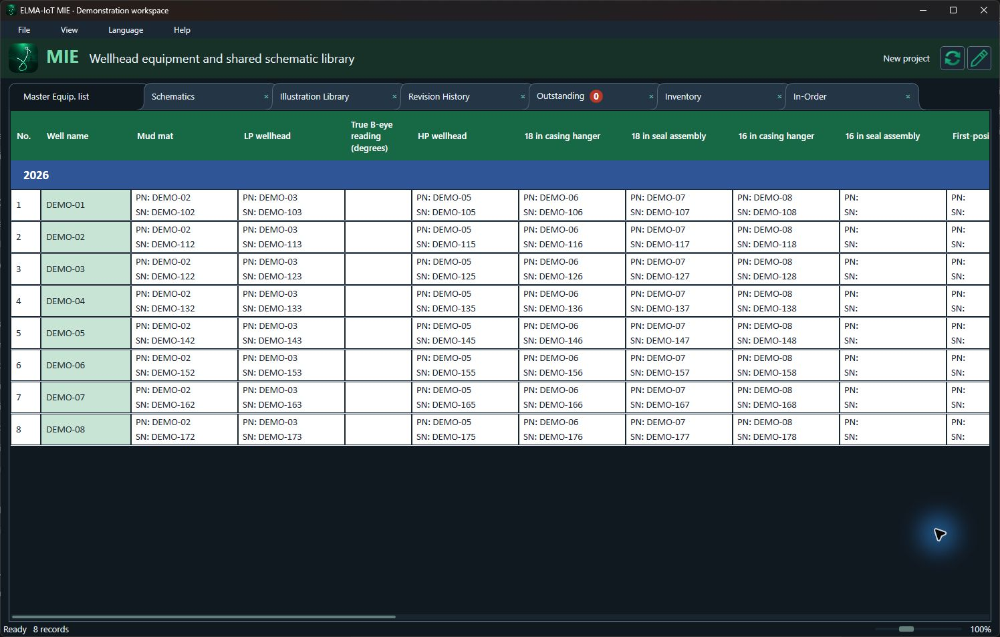

*The Master equipment list organizes installed parts and serials by well so the team can find the record alongside its schematic.*

## Storage and equipment lifecycle

In **3D Map**, mark named shelf and floor locations in a 3D facility, place equipment on pallets, and arrange the pallets. Click **3D Map Location** in Inventory to fly to the exact item. In the workshop view, hover over equipment for its part number, serial number, and description, or choose **See in Inventory** to open its row.

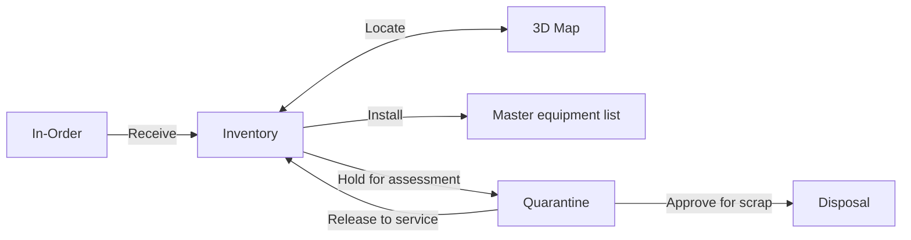

| Inventory and Quarantine | Named approvals |
|---|---|
| 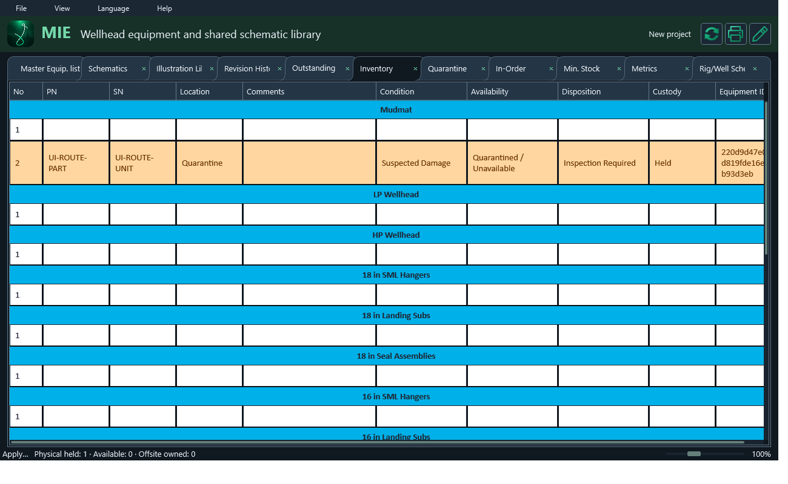 | 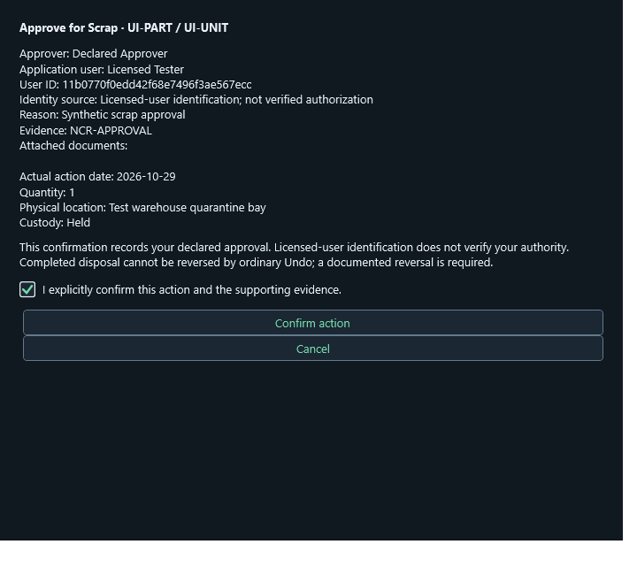 |
| A retained link shows the equipment's Quarantine status in Inventory so teams can see that it is unavailable. | Confirm lifecycle actions with an identified approver and supporting evidence. |

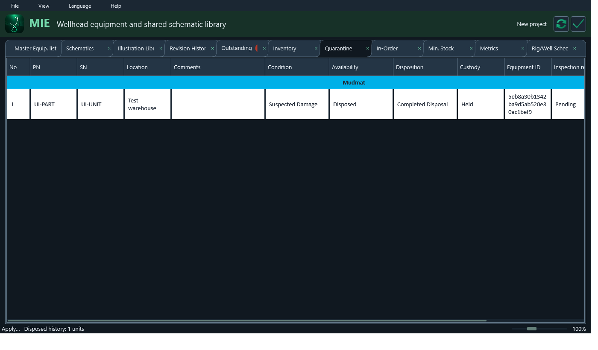

*Disposal preserves the serial's history, evidence, and completion record for review.*

## 3D models and inspections

Open a GLB model for an equipment item and record service information with serial-specific notes, marks, or damage. Saved annotations follow the item across Inventory, Quarantine, and Disposal. Technical references can open the matching page in an indexed manual.

| Model view | Recording equipment damage |
|---|---|
| 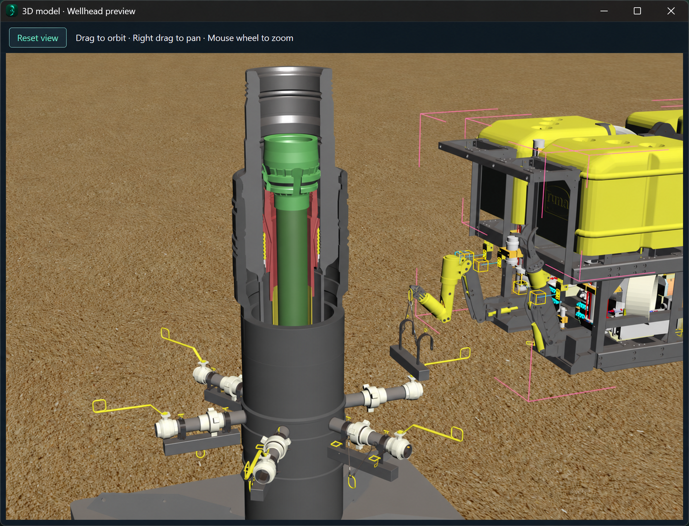 |  |
| This illustrated wellhead preview shows how a model fits into the viewer workspace. | The video demonstrates locating and marking damage on an equipment model. |

## Drawings and project updates

Keep drawings with the well they describe. When a revised drawing arrives, review its equipment mappings before applying changes. When combining projects, compare incoming fields before updating the working register.

| Replace a linked drawing | Review an incoming project |
|---|---|
|  | 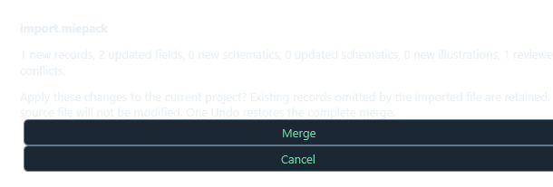 |
| Replace opens a revised source for the existing well and lets you review the associated equipment update. | Import review shows differences so the team can decide which changes belong in the merged project. |

## Planning and reporting

The licensed planning views connect rig and well activities to equipment requirements and expected deliveries. Use historical wells to review minimum-stock suggestions and prepare for upcoming jobs.

| Rig and well planning | Minimum-stock suggestions |
|---|---|
| 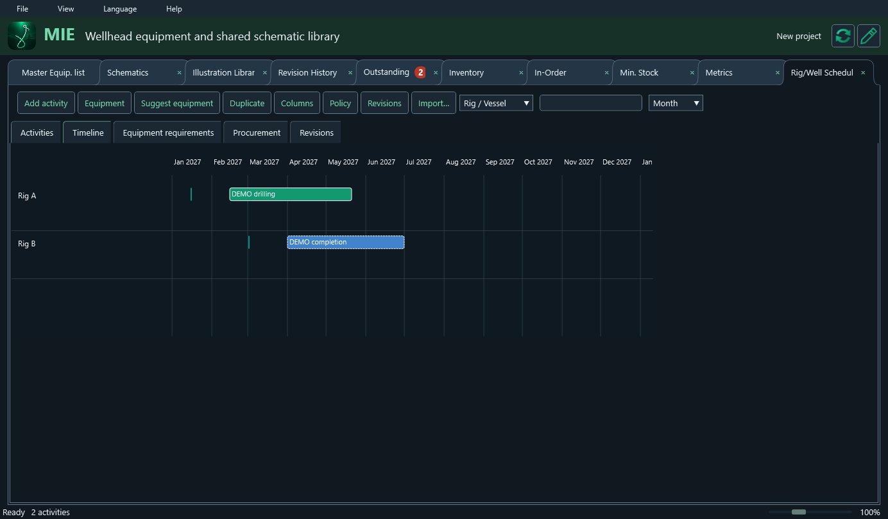 | 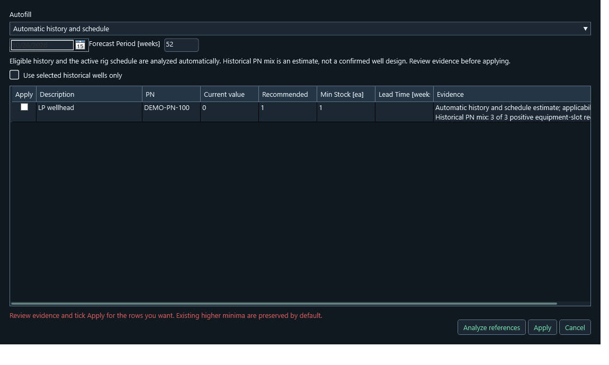 |
| Review activities and their timing along the well schedule. | Review suggested quantities before applying them to minimum-stock policies. |

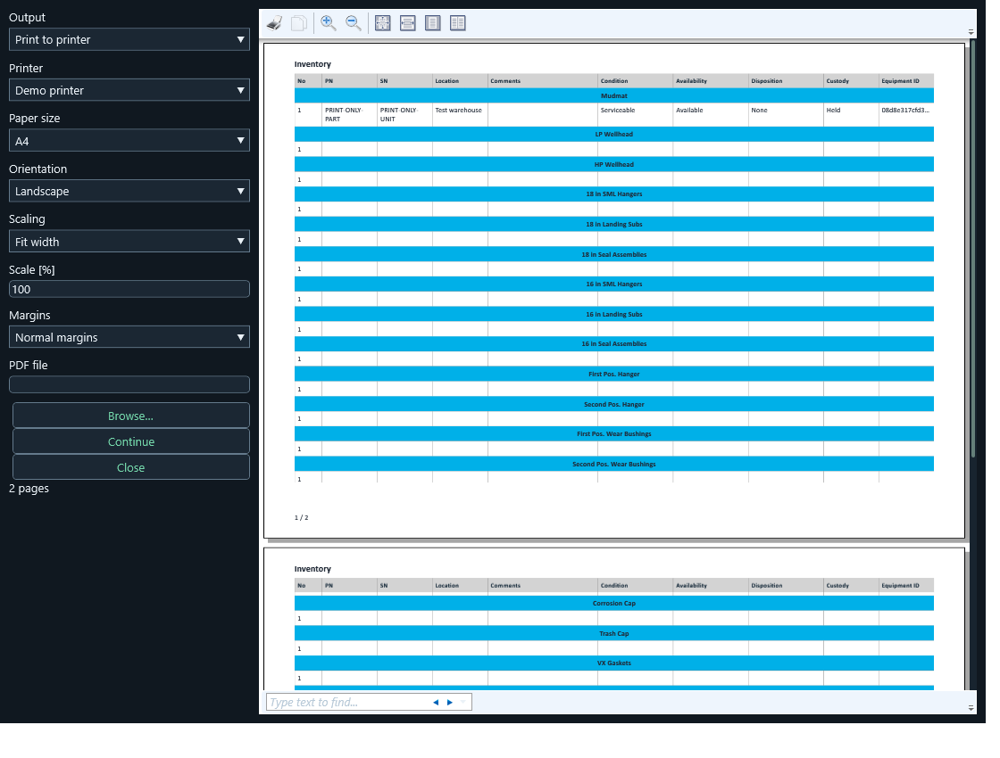

*Preview the active worksheet, choose its page setup, and print or save it as a PDF.*

## Workspace appearance

| Equipment color assignment | Theme Studio |
|---|---|
| 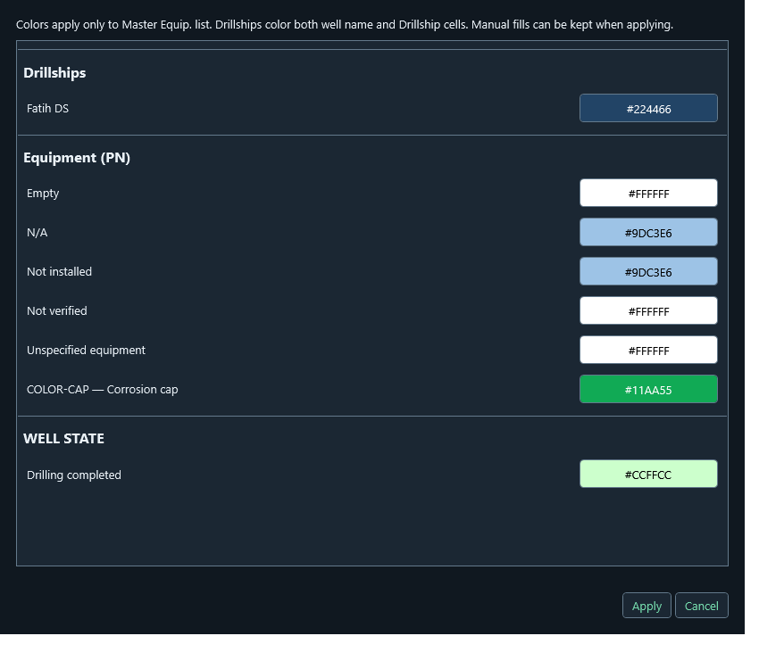 | 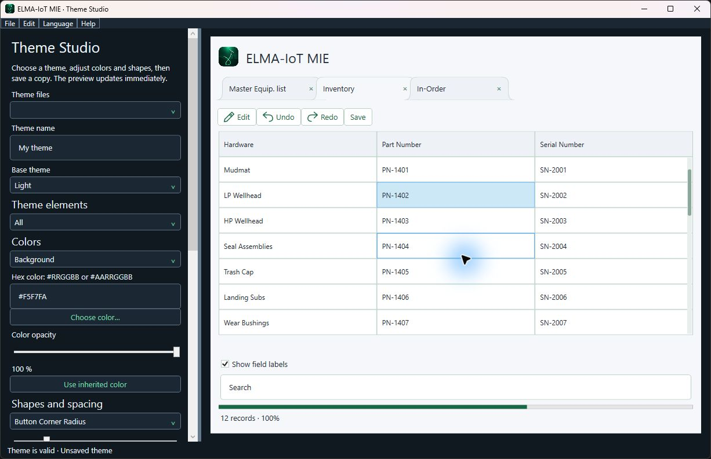 |
| Assign colors to drillships, part numbers, and well states so teams can spot them in the Master list. | Preview colors, text, and controls as you adjust the workspace theme. |

## Get started

MIE runs on Windows 10 and 11 with .NET Framework 4.8. Open **Help** for the guide and walkthroughs. Use **Help → Packs** to find compatible downloads. [Public content releases](https://github.com/elma-iot/ELMA-IoT-MIE/releases)

For support, share the app version, Windows version, and steps to reproduce with a synthetic or redacted example. [Issues and feedback](https://github.com/elma-iot/ELMA-IoT-MIE/issues)
