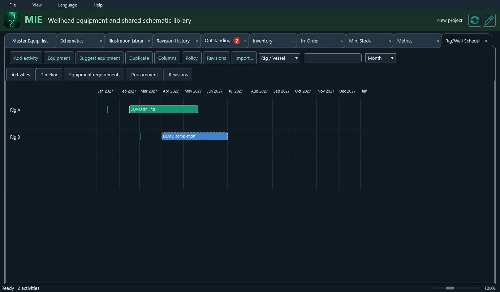
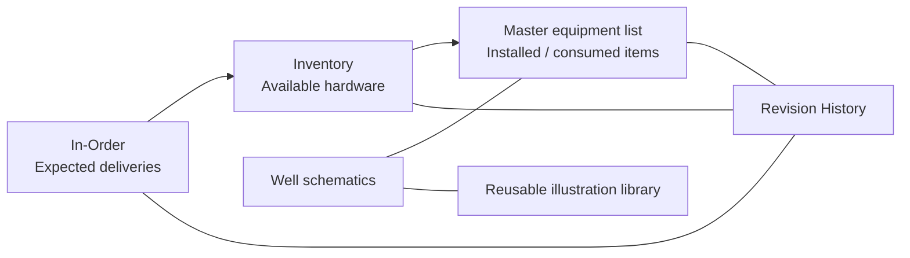
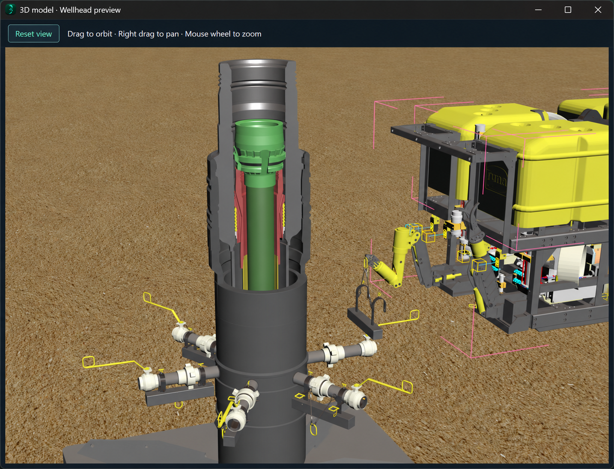

# ELMA-IoT MIE

### From the purchase order to the installed wellhead.

**Equipment traceability · Well schematics · Shared illustration library**

A focused Windows workspace for subsea wellhead hardware and consumables, built for the people planning, preparing, transporting and installing them.

[Microsoft Store listing](https://apps.microsoft.com/detail/9NSZMSQKXH67) · [Optional content](https://github.com/elma-iot/ELMA-IoT-MIE/releases/tag/mie-content-v24) · [Support and feedback](https://github.com/elma-iot/ELMA-IoT-MIE/issues) · [ELMA-IoT](https://github.com/elma-iot)

> **1.15.2 review:** Add several master columns with a trailing plus and trash controls; Add closes immediately and applies one undoable batch. Existing headings can be renamed while keeping equipment and planning field identities stable. Excel now physically follows the displayed master column order and custom worksheet headings; use MIE 1.15.2 or later to reimport these exports with their hidden field names intact. The duplicate-key error with formatted empty headers is fixed. See [release notes](ReleaseNotes-1.15.2-review.txt) and separate [twenty-language content v24](https://github.com/elma-iot/ELMA-IoT-MIE/releases/tag/mie-content-v24), including 51 guide topics and updated demonstrations. Source and the review EXE remain private.

> **1.15.0 review:** The licensed Rig/Well Schedule workspace adds editable activities and Gantt planning, reviewed equipment requirements, chronological procurement, scenarios and named revisions. It includes reviewed schedule imports and selective licensed Excel export of inputs, procurement and Gantt snapshots. Enabling planning is an explicit migration with a recovery copy; projects using this module require reader 1.15.0, while older projects open without enabling it. Existing licenses remain valid on their issued Windows installation. Source and the review EXE remain private. See [release notes](ReleaseNotes-1.15.0-review.txt) and separate [twenty-language content v22](https://github.com/elma-iot/ELMA-IoT-MIE/releases/tag/mie-content-v22). This does not announce a Microsoft Store publication.

> **1.14.1 review:** Reparse a schematic already linked to a well using the small refresh icon beside its name. Read mode offers detected updates; edit mode offers force reparse for every available schematic. The existing review dialog handles field mapping and conflicts before changes are applied. Background checks are cached and never edit equipment automatically. See [release notes](ReleaseNotes-1.14.1-review.txt); updated twenty-language learning and interface content is in [content v21](https://github.com/elma-iot/ELMA-IoT-MIE/releases/tag/mie-content-v21). The review executable and source remain private.
> **1.14.0 review update:** Quantity-based orders and partial receiving now connect to licensed Min. Stock policies and a Metrics dashboard based on recorded stock movements and actual delivery dates. Min. Stock and Metrics are hidden when the license is inactive; saved planning data is retained. Selective XLSX export includes numeric metrics, native charts and author metadata. Interface, guide and tutorial updates for all twenty languages remain separate [on-demand packs (v20)](https://github.com/elma-iot/ELMA-IoT-MIE/releases/tag/mie-content-v21). New planning-schema saves require reader 1.14.0; use Save as for a separate review copy. See [review release notes](ReleaseNotes-1.14.0-review.txt). The review executable and source are private; this does not announce a Microsoft Store publication.

> **Version 1.12.2.** Shared drawing storage reduces repeated native schematic content while preserving positions, scales and transforms. Subsequent master-only saves reuse the compressed drawing archive. Linked well names appear underlined, and unavailable licensed options explain activation or renewal through Get License. Translations and the interactive guide/tutorials remain separate on-demand data packs; the 1.12.2 language/learning update is [content v13](https://github.com/elma-iot/ELMA-IoT-MIE/releases/tag/mie-content-v13), while the other compatible content remains available through the in-app pack menu and earlier releases. **Compatibility:** older projects remain readable; projects saved in the compact format require MIE 1.12.0 or later. Keep an older-format copy when exchanging with earlier versions. Microsoft Store version **1.11.11.0 is published**. Version **1.12.2.0** and its updated product description/release notes were submitted on **21 October 2026** as **Submission 6**; Partner Center confirmed **In certification**, with automatic publication after approval. Check the Store listing for the version currently available. Equipment-table screenshots use synthetic demonstration data. The viewer illustration uses the supplied wellhead image inside an application frame and is labeled as an illustrative preview.

## 1.13.3

Inventory and In-Order now use a shared field header above editable equipment sections. Editors preserve the displayed text and fill formatting while typing and after commit. Row/section additions, custom information columns, duplicate warnings, stock receipt/installation and Excel round-tripping remain available. The compact header keeps Sync and Edit visible with long saved filenames.

This audit reduces repeated worksheet parsing, reuses stock row templates, coalesces hidden-tab refreshes and indexes stock cell lookups. On one 9.25 MB project copy, median edit processing improved from 748 ms to 673 ms and editor preparation from 660 ms to 486 ms; measurements vary by PC and project. Project storage and encryption were retained.

Incremental compressed sync uses passive shared storage, immutable batches, snapshots and field-level conflict review. **Check legacy backup** is off by default and enables read-only reconciliation only when selected. The current guide/tutorials and all twenty languages are on-demand [content v19 packs](https://github.com/elma-iot/ELMA-IoT-MIE/releases/tag/mie-content-v19). Source and application binaries are released privately. [Release notes](ReleaseNotes-1.13.3.txt). Microsoft Store submission status will be updated after Partner Center confirms it.

## 1.13.2 review update

Inventory and In-Order use stacked equipment sections with editable titles and separate PN, SN, Location and Comments columns. Add an item row or equipment section with the green +; add and remove custom information columns with the far-right + and recycle bin. Receipt, installation, undo, revisions and duplicate checks retain their existing behavior. Excel export and reimport support the section layout. Formula-bearing or formula-referenced stock sheets retain native coordinates on export.

**Check legacy backup** in Sync settings is off by default. When off, neither metadata nor content of the old single-file backup is read during sync. Enable it for read-only legacy reconciliation. This setting applies across folder/network and supported cloud providers. Incremental changes and snapshots continue independently.

Updated guides and all twenty language translations are separate [content v18 data packs](https://github.com/elma-iot/ELMA-IoT-MIE/releases/tag/mie-content-v18). Source and review EXE remain private. This user-review build has not been submitted to Microsoft Store. [Release notes](ReleaseNotes-1.13.2-review.txt).

## 1.13.1 review update

The review build adds incremental synchronization through passive folders, network shares and supported cloud storage. Compressed immutable transaction batches, a conditional commit index and periodic snapshots exchange only missing changes and new resources. Compression-only sync needs no encryption key; optional encryption reuses the existing Generate key, Copy key and Load key backup controls. Existing encrypted local projects and recovery copies retain protection.

Legacy single-file shared backups stay read-only and can be reconciled as older clients update them. A complete backup folder can be copied to another PC and restored offline or merged with field review. Local project storage and the existing journal/merge/audit components remain in place. Snapshot thresholds are configurable and historical data is retained.

All twenty language and guide/tutorial updates are separate [content v17 data packs](https://github.com/elma-iot/ELMA-IoT-MIE/releases/tag/mie-content-v17). Application source and review binaries remain private. This is a separate test build and has not been submitted to Microsoft Store. [Review release notes](ReleaseNotes-1.13.1-review.txt).

## 1.13.0 review update

The review version adds automatic synchronization after pairing, three-way field and PN/SN merging, conflict decisions, stable row identities, audit history and encrypted offline recovery. Shared storage remains a single project file; changed projects still transfer as complete archives. No database migration or encryption removal is included. Complex simultaneous layouts, formulas or formatting changes preserve both copies for reconciliation. Projects saved with synchronization tracking require MIE 1.13.0 or later.

The updated translations and guide/tutorials for all 20 languages are separate on-demand data packs in [content v15](https://github.com/elma-iot/ELMA-IoT-MIE/releases/tag/mie-content-v15). Application binaries and source remain in the private repository. This is a review build and has not been submitted to Microsoft Store. See [1.13.0 review notes](ReleaseNotes-1.13.0-review.txt).

## Built around the equipment lifecycle

Track what has been ordered, what has arrived and what has been installed against each well. Keep part numbers, serial numbers and order dates close to the drawing and the equipment record. Matching suggestions and duplicate explanations help reduce transcription mistakes and make stock movements easier to review.

| People and teams | Practical benefit |
|---|---|
| Offshore field service engineers | Find the well record and schematic together; record installed hardware and consumption. |
| Onshore base and workshop personnel | Maintain available stock and identify matching equipment before mobilization. |
| Planning and logistics | Follow expected deliveries, overdue arrival dates and available inventory. |
| Service delivery managers | Review project status, outstanding actions and the recorded change history. |
| Clients and project partners | Share a consistent equipment register and exchange familiar Excel deliverables. |

MIE is specialized for wellhead equipment workflows in upstream oil and gas operations. It supports individual engineers as well as teams working across an onshore base, planning office and offshore operation.

## One project, connected views

| View | What it brings together |
|---|---|
| **Master equipment list** | Well rows, year separators, hardware categories and installed part/serial details. |
| **In-Order** | Equipment on order, order dates and expected arrival dates; overdue arrivals are highlighted. |
| **Inventory** | Available hardware, matching suggestions and transfers into the installed equipment list. |
| **Schematics** | Linked well drawings, zoomable previews and source documents. |
| **Illustration Library** | Reusable images and native vector groups, with placement dimensions, rotation and flips retained for each occurrence. |
| **Outstanding** | Follow-up actions and a visible open-action count. |
| **Revision History** | Recorded edits and movements with user identity, time and before/after details. |

### Work quickly without losing context

- Edit cells directly, retain workbook dropdown choices, format text and cells, and use worksheet undo/redo.
- Add or rename well rows and year dividers. Confirm row removal before committing it.
- Inspect glowing red duplicate/conflict cells for explanations and matching records. The glow stops when the issue is resolved and stays steady when Windows animations are disabled.
- Press **F** or **Ctrl+F** for an overlay with find/replace. Expand the advanced options for case, whole words, regular expressions, scope and wrapping. Replacements enable editing when needed.
- Use the mouse wheel with **Ctrl** to zoom, or the slim footer slider. Each tab retains its own zoom and scroll position.
- Drag tab headers to rearrange them. Detach views onto another monitor, reattach them, or close the detached window to return its tab.
- Use Windows Snap Layouts for side-by-side work. Window positions, attached/detached views, tab visibility and order are remembered.
- Hover feedback, centered icons, narrow themed scrollbars and a compact footer keep the focus on project data.

## Keep the drawing with the record

Click a well link to open its schematic or import a missing drawing. The library reuses identical illustration content across wells instead of storing another copy every time. Each placement still keeps its own size, scale, rotation and flips.

Work with supported Excel and PDF source drawings, open the saved previews, and export schematics to XLSX, PDF, PNG or JPEG. Native Excel source objects are retained where available. PDF-origin workbook exports are image-based references; the original PDF is retained alongside the export.

**Save project as XLSX** reconstructs the master workbook and linked Schematics folder for review or further work in Microsoft Excel. Supported edited workbooks can be imported back into MIE. The portable project format keeps the project and its required resources together; **Zip project** packages the current deliverable for transfer.

## New: optional GLB 3D model viewer

*Illustrative preview: the supplied wellhead picture is placed inside the application frame. This is not a captured rendering of an imported GLB file.*

Illustrations can now include **static GLB 2.0 models** alongside flat images and native vector previews. Choose **Illustration Library → Import 3D model**. The separate viewer pack downloads on first use, then remains available offline.

| Control | Action |
|---|---|
| Left mouse drag | Orbit around the model |
| Right mouse drag | Pan the view |
| Mouse wheel | Zoom in or out |
| Reset view | Fit the complete model |

GLB data is stored inside the project and deduplicated. Importing through a schematic's placement-details window also links the model to that schematic. A model does not replace the Excel schematic or its 2D illustration.

The initial viewer supports triangle meshes, node transforms, base colors and embedded PNG/JPEG textures in GLB files up to **32 MB**. Rendering approximates materials; it is not a full PBR renderer. Skins, sparse accessors, compression extensions and external resources are not supported yet. **Wellhead model libraries will be published separately later.** The pictured wellhead is a supplied illustration, not a downloadable model library or a GLB compatibility test.

## Share changes and keep recovery options

Synchronization retrieves other users' changes as well as sending local changes. It supports configured local/network destinations and licensed cloud connections. Conflicting changes require review rather than silently replacing a competing value. Progress reflects completed work and transferred bytes; the sync details window exposes the log and is enabled by default when starting synchronization.

The Store edition checks Microsoft Store for available updates at startup and through **Help → Check for updates**. It offers to open the Store when an update is available; Microsoft Store handles installation and automatic updates according to the device settings. The portable EXE does not update itself.

Projects retain versioned backups and recovery options. Save/Discard/Cancel prompts protect unsaved work before closing or replacing a project. Saving, loading, resource preparation and supported import/export operations use background work so the interface can remain available. Graphics acceleration is used where available, with a software fallback.

**Licensing:** the free edition includes the core workspace and local-server synchronization. Active owner-issued licenses can add branding, cloud synchronization and new data encryption, according to the issued grant. Licenses may be issued to customers or partners; a recurring paid subscription is not required by the activation workflow. Pricing and terms come from the project owner. Licensed features require an HTTPS time check at startup. On expiry, project data and encryption keys are retained; creating new encrypted backups and using licensed cloud sync are restricted. Local unencrypted backup choices are explained before proceeding.

## Make the workspace your own

**Light, Dark and Auto** themes are included. **Theme Studio** is a separate, optional utility with the same visual language as MIE. Its preview uses the application's button and tab renderer.

Customize button fills and borders for normal, hover and pressed states; typography and text colors; cell and selection styling; tab corners and overlap; spacing and scrollbar sizes; and optional bevel, shadow and depth effects. Defaults preserve the current appearance. Display overrides leave saved workbook formatting unchanged, and red conflict warnings are retained.

The application generates readable **Themes/Light.json** and **Themes/Dark.json** examples. Save a custom theme into **Themes**, then reopen **View → Theme** to select it. Schema version 2 separates `Colors`, `Metrics` and `Typography`; version 1 files remain supported. The editor validates theme values before saving.

## Twenty languages, one download

English is available immediately. Selecting another language downloads **one combined language pack** containing all additional translations, rather than a separate pack per language. All installed translations then work offline. Language names remain in their native languages in the selector, and Arabic/Persian layouts support right-to-left interface flow. Project and imported equipment text retain their original content.

Editable UTF-8 JSON files in **locales** are formatted across readable lines. Existing customized translations are preserved. The searchable user guide and guided tutorials also have translated content. Tutorials run over the current workspace and restore it when finished.

## A small core with optional packs

Essential project editing, stock movement, source handling, save/recovery and local project work remain in the main application. Extra content downloads when requested and is cached locally for later offline use.

| Optional feature | How to get it |
|---|---|
| Classic games and game window/controls | Included in the current app; matching standalone host DLL is public below |
| Nebula Vanguard, native 3D solar system | Optional game module; download through the app |
| All interface translations | Select a language, or use **Help → Packs** |
| User guide and tutorials | Open the guide/tutorial, or use **Help → Packs** |
| Theme Studio | **View → Theme → Theme Studio**, or **Help → Packs** |
| GLB 3D viewer | Import/open a model, or use **Help → Packs** in the portable edition |

Pack downloads show measured progress. The app verifies the signed release catalog and each package's SHA-256 checksum before loading it. Downloads fetch public application assets; they do not upload a project. A failed download leaves existing content and project data intact.

Use the application's pack menu for compatible versions. The public [optional-content release](https://github.com/elma-iot/ELMA-IoT-MIE/releases/tag/mie-content-v21) is also available for reference; old catalogs remain available for earlier application versions.

## Get started

1. Open MIE and create an empty project, open a saved project, or import supported existing workbooks.
2. Set up well rows and equipment categories, then record ordered equipment with its expected delivery dates.
3. Receive matching hardware into Inventory and consume/install it into the master equipment list.
4. Link well schematics and review reused illustrations. Add a GLB model if you need a 3D reference.
5. Review outstanding actions and change history. Save the portable project and configure synchronization if required.
6. Export the Excel/drawing deliverable or package the project. Use **Help** for the searchable guide and replayable tutorials.

## Requirements and compatibility

- **Windows 10/11**, with **.NET Framework 4.8**.
- **Microsoft Excel** is needed on the importing PC for the supported Excel schematic rendering workflow. Saved previews can be viewed without Excel. Source workbooks are opened read-only with macros, events and external-link updates disabled.
- PNG/JPEG previews and the optional GLB viewer use Windows/WPF rendering; separate image-reader software is not required for those views.
- Initial optional-pack downloads require internet access. Installed packs and normal local project work are available offline. Licensed startup checks and remote synchronization have their own connectivity requirements.
- The portable edition supports the downloadable executable extensions described above. Store-edition capabilities and version availability can differ.

## Feedback, distribution and repository scope

Use the [issue tracker](https://github.com/elma-iot/ELMA-IoT-MIE/issues) for reproducible problems and feature suggestions. Include the application version, Windows version and steps to reproduce. Use synthetic or redacted examples rather than posting customer equipment records or confidential drawings.

This public repository hosts product information, branding, demonstration screenshots and optional-content releases. Application source is maintained privately. No customer project data, owner signing keys, activation utilities or data-bearing application bundles are published here. The equipment workspace and Theme Studio screenshots use purpose-built synthetic data. The labeled viewer preview composites the supplied wellhead illustration inside an application frame.

Copyright © 2026 ELMA IoT. All rights reserved. This information page does not grant a license to application source or organizational branding.

## Current public pack downloads

The [v13 data-pack release](https://github.com/elma-iot/ELMA-IoT-MIE/releases/tag/mie-content-v13) contains the language and learning packs for MIE 1.12.2. The other modules remain in the [v12 complete module release](https://github.com/elma-iot/ELMA-IoT-MIE/releases/tag/mie-content-v21). Use the in-app pack menu for compatible downloads; earlier releases remain available at their original URLs.

| Pack | Current version | File |
|---|---|---|
| Classic games and shared host | 1.11.11 | [Game host DLL](https://github.com/elma-iot/ELMA-IoT-MIE/releases/download/mie-content-v12/MIE-Arcade-Pack-1.11.11.dll) |
| Nebula Vanguard | 1.11.7 | [Native 3D game DLL](https://github.com/elma-iot/ELMA-IoT-MIE/releases/download/mie-content-v12/MIE-Nebula-Vanguard-1.11.7.dll) |
| All 20 interface languages | 1.12.2 | [Language ZIP](https://github.com/elma-iot/ELMA-IoT-MIE/releases/download/mie-content-v13/MIE-Languages-1.12.2.zip) |
| User guide and tutorials | 1.12.2 | [Learning ZIP](https://github.com/elma-iot/ELMA-IoT-MIE/releases/download/mie-content-v13/MIE-Learning-1.12.2.zip) |
| Theme Studio | 1.11.0 | [Theme editor](https://github.com/elma-iot/ELMA-IoT-MIE/releases/download/mie-content-v12/MIE-Theme-Studio-1.11.0.exe) |
| GLB model viewer | 1.11.0 | [Viewer DLL](https://github.com/elma-iot/ELMA-IoT-MIE/releases/download/mie-content-v12/MIE-GLB-Viewer-1.11.0.dll) |

The current portable EXE already embeds the classic-game host, including the common game window and controls. The standalone public DLL is the identical module, provided for completeness; it does not run by itself and requires no manual installation in the current app. Nebula is a separate optional renderer. Use the application's pack menu to obtain compatible downloads. Store builds bundle executable modules in their MSIX. Language and learning data remain separate on-demand downloads and work offline after installation.

The public release collects matching files without changing the original catalog, trusted hashes or runtime URLs. Application source and the main portable EXE remain private. No operational project data is included.

## Open and recent projects in 1.11.5

File > Open lists five recent projects with filename, last-saved date/time and folder so identically named files can be distinguished. Ctrl+O and Browse open another file. Save updates the active file; first Save and Save as suggest timestamped filenames, with a counter when the suggested copy name exists. Existing files are not renamed.

The [1.11.5 language and learning packs](https://github.com/elma-iot/ELMA-IoT-MIE/releases/tag/mie-content-v7) include this guidance and the shortened Open label in all 20 languages. They retain all earlier Save/Save as and shortcut documentation and are downloaded on demand by version 1.11.5.

The current [Microsoft Store product description](StoreListing-en.txt) covers equipment traceability, schematic autofill, duplicate glows and hover cards, synchronization feedback, on-demand language/guide packs, requirements and Free/licensed features. It was refreshed with the 1.12.2.0 submission. See the [1.12.2 release notes](ReleaseNotes-1.12.2.txt) for shared drawing storage, linked-well styling and licensed-feature prompt changes.
