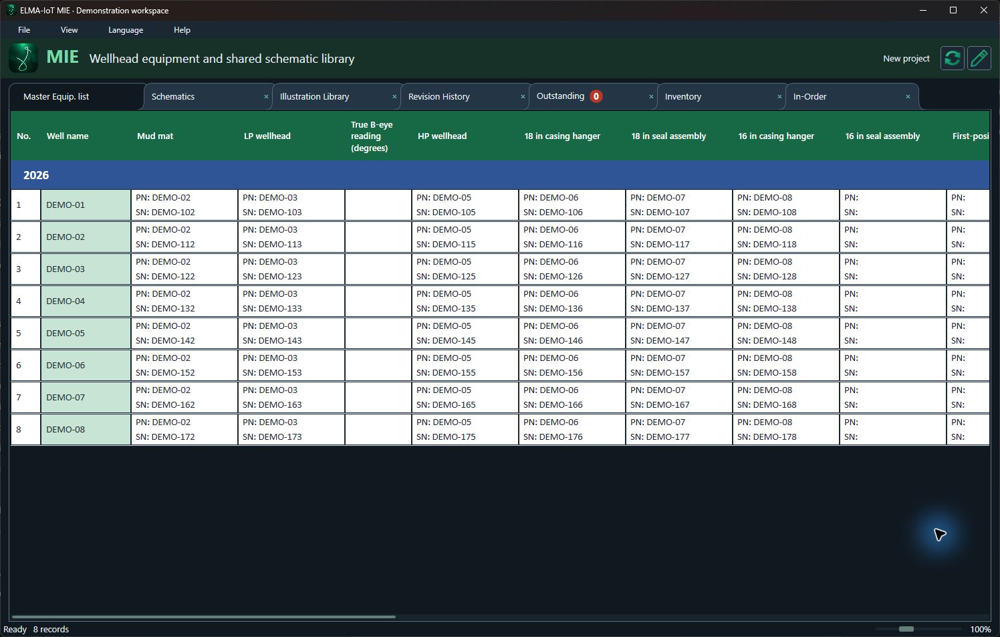
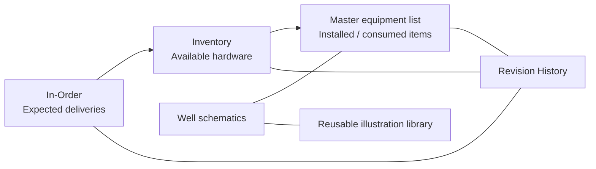
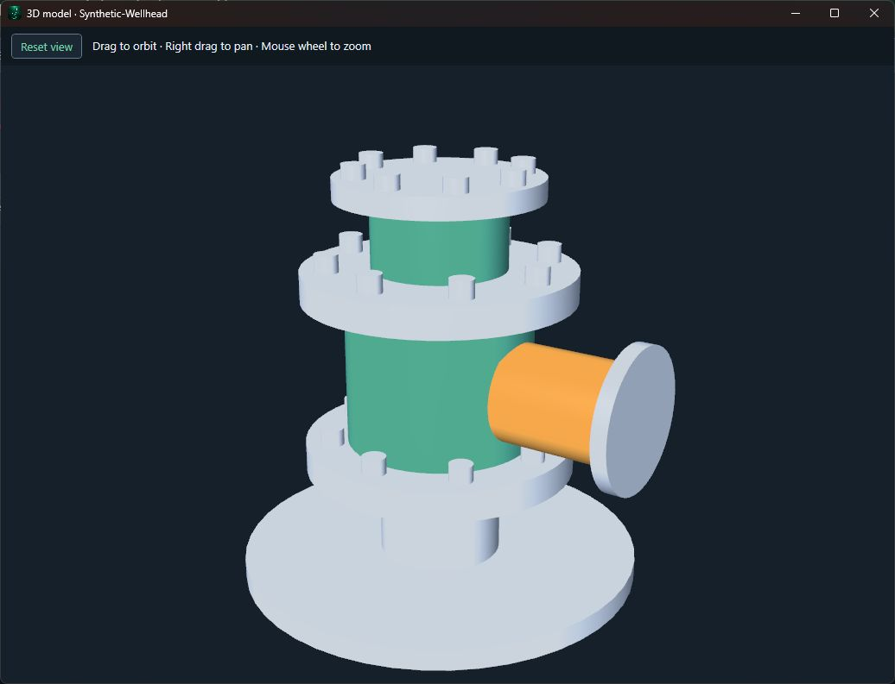
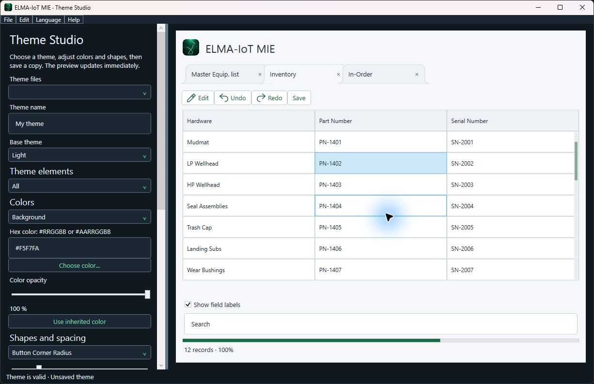

# ELMA-IoT MIE

### From the purchase order to the installed wellhead.

**Equipment traceability · Well schematics · Shared illustration library**

A focused Windows workspace for subsea wellhead hardware and consumables, built for the people planning, preparing, transporting and installing them.

[Microsoft Store listing](https://apps.microsoft.com/detail/9NSZMSQKXH67) · [Optional content](https://github.com/elma-iot/ELMA-IoT-MIE/releases/tag/mie-content-v5) · [Support and feedback](https://github.com/elma-iot/ELMA-IoT-MIE/issues) · [ELMA-IoT](https://github.com/elma-iot)

> **Maintenance release 1.11.10.** Duplicate and stock-warning cells now glow gently; hover cards show the matching wells or stock entries. The portable edition includes selected-row autofill from readable XLSX schematic labels, retaining existing conflicting entries for review. Project/tab responsiveness and native optional-content rendering improvements are retained. The main executable remains about 1.59 MB; full translations and the interactive guide/tutorials download on demand. Use the in-app pack menu to select compatible downloads. Earlier catalogs remain available. A refreshed Store upload candidate has been built and locally checked; submission is pending Partner Center access. Check the Store listing for the currently available version. All screenshots use synthetic demonstration data.

## Built around the equipment lifecycle

Track what has been ordered, what has arrived and what has been installed against each well. Keep part numbers, serial numbers and order dates close to the drawing and the equipment record. Matching suggestions and duplicate explanations help reduce transcription mistakes and make stock movements easier to review.

| People and teams | Practical benefit |
|---|---|
| Offshore field service engineers | Find the well record and schematic together; record installed hardware and consumption. |
| Onshore base and workshop personnel | Maintain available stock and identify matching equipment before mobilization. |
| Planning and logistics | Follow expected deliveries, overdue arrival dates and available inventory. |
| Service delivery managers | Review project status, outstanding actions and the recorded change history. |
| Clients and project partners | Share a consistent equipment register and exchange familiar Excel deliverables. |

MIE is specialized for wellhead equipment workflows in upstream oil and gas operations. It supports individual engineers as well as teams working across an onshore base, planning office and offshore operation.

## One project, connected views

| View | What it brings together |
|---|---|
| **Master equipment list** | Well rows, year separators, hardware categories and installed part/serial details. |
| **In-Order** | Equipment on order, order dates and expected arrival dates; overdue arrivals are highlighted. |
| **Inventory** | Available hardware, matching suggestions and transfers into the installed equipment list. |
| **Schematics** | Linked well drawings, zoomable previews and source documents. |
| **Illustration Library** | Reusable images and native vector groups, with placement dimensions, rotation and flips retained for each occurrence. |
| **Outstanding** | Follow-up actions and a visible open-action count. |
| **Revision History** | Recorded edits and movements with user identity, time and before/after details. |

### Work quickly without losing context

- Edit cells directly, retain workbook dropdown choices, format text and cells, and use worksheet undo/redo.
- Add or rename well rows and year dividers. Confirm row removal before committing it.
- Inspect glowing red duplicate/conflict cells for explanations and matching records. The glow stops when the issue is resolved and stays steady when Windows animations are disabled.
- Press **F** or **Ctrl+F** for an overlay with find/replace. Expand the advanced options for case, whole words, regular expressions, scope and wrapping. Replacements enable editing when needed.
- Use the mouse wheel with **Ctrl** to zoom, or the slim footer slider. Each tab retains its own zoom and scroll position.
- Drag tab headers to rearrange them. Detach views onto another monitor, reattach them, or close the detached window to return its tab.
- Use Windows Snap Layouts for side-by-side work. Window positions, attached/detached views, tab visibility and order are remembered.
- Hover feedback, centered icons, narrow themed scrollbars and a compact footer keep the focus on project data.

## Keep the drawing with the record

Click a well link to open its schematic or import a missing drawing. The library reuses identical illustration content across wells instead of storing another copy every time. Each placement still keeps its own size, scale, rotation and flips.

Work with supported Excel and PDF source drawings, open the saved previews, and export schematics to XLSX, PDF, PNG or JPEG. Native Excel source objects are retained where available. PDF-origin workbook exports are image-based references; the original PDF is retained alongside the export.

**Save project as XLSX** reconstructs the master workbook and linked Schematics folder for review or further work in Microsoft Excel. Supported edited workbooks can be imported back into MIE. The portable project format keeps the project and its required resources together; **Zip project** packages the current deliverable for transfer.

## New: optional GLB 3D model viewer

Illustrations can now include **static GLB 2.0 models** alongside flat images and native vector previews. Choose **Illustration Library → Import 3D model**. The separate viewer pack downloads on first use, then remains available offline.

| Control | Action |
|---|---|
| Left mouse drag | Orbit around the model |
| Right mouse drag | Pan the view |
| Mouse wheel | Zoom in or out |
| Reset view | Fit the complete model |

GLB data is stored inside the project and deduplicated. Importing through a schematic's placement-details window also links the model to that schematic. A model does not replace the Excel schematic or its 2D illustration.

The initial viewer supports triangle meshes, node transforms, base colors and embedded PNG/JPEG textures in GLB files up to **32 MB**. Rendering approximates materials; it is not a full PBR renderer. Skins, sparse accessors, compression extensions and external resources are not supported yet. **Wellhead model libraries will be published separately later.** The pictured model is a synthetic demonstration, not a published equipment model library.

## Share changes and keep recovery options

Synchronization retrieves other users' changes as well as sending local changes. It supports configured local/network destinations and licensed cloud connections. Conflicting changes require review rather than silently replacing a competing value. Progress reflects completed work and transferred bytes; the sync details window exposes the log and is enabled by default when starting synchronization.

Projects retain versioned backups and recovery options. Save/Discard/Cancel prompts protect unsaved work before closing or replacing a project. Saving, loading, resource preparation and supported import/export operations use background work so the interface can remain available. Graphics acceleration is used where available, with a software fallback.

**Licensing:** the free edition includes the core workspace and local-server synchronization. Active owner-issued licenses can add branding, cloud synchronization and new data encryption, according to the issued grant. Licenses may be issued to customers or partners; a recurring paid subscription is not required by the activation workflow. Pricing and terms come from the project owner. Licensed features require an HTTPS time check at startup. On expiry, project data and encryption keys are retained; creating new encrypted backups and using licensed cloud sync are restricted. Local unencrypted backup choices are explained before proceeding.

## Make the workspace your own

**Light, Dark and Auto** themes are included. **Theme Studio** is a separate, optional utility with the same visual language as MIE. Its preview uses the application's button and tab renderer.

Customize button fills and borders for normal, hover and pressed states; typography and text colors; cell and selection styling; tab corners and overlap; spacing and scrollbar sizes; and optional bevel, shadow and depth effects. Defaults preserve the current appearance. Display overrides leave saved workbook formatting unchanged, and red conflict warnings are retained.

The application generates readable **Themes/Light.json** and **Themes/Dark.json** examples. Save a custom theme into **Themes**, then reopen **View → Theme** to select it. Schema version 2 separates `Colors`, `Metrics` and `Typography`; version 1 files remain supported. The editor validates theme values before saving.

## Twenty languages, one download

English is available immediately. Selecting another language downloads **one combined language pack** containing all additional translations, rather than a separate pack per language. All installed translations then work offline. Language names remain in their native languages in the selector, and Arabic/Persian layouts support right-to-left interface flow. Project and imported equipment text retain their original content.

Editable UTF-8 JSON files in **locales** are formatted across readable lines. Existing customized translations are preserved. The searchable user guide and guided tutorials also have translated content. Tutorials run over the current workspace and restore it when finished.

## A small core with optional packs

Essential project editing, stock movement, source handling, save/recovery and local project work remain in the main application. Extra content downloads when requested and is cached locally for later offline use.

| Optional feature | How to get it |
|---|---|
| All interface translations | Select a language, or use **Help → Packs** |
| User guide and tutorials | Open the guide/tutorial, or use **Help → Packs** |
| Theme Studio | **View → Theme → Theme Studio**, or **Help → Packs** |
| GLB 3D viewer | Import/open a model, or use **Help → Packs** in the portable edition |

Pack downloads show measured progress. The app verifies the signed release catalog and each package's SHA-256 checksum before loading it. Downloads fetch public application assets; they do not upload a project. A failed download leaves existing content and project data intact.

Use the application's pack menu for compatible versions. The public [optional-content release](https://github.com/elma-iot/ELMA-IoT-MIE/releases/tag/mie-content-v5) is also available for reference; old catalogs remain available for earlier application versions.

## Get started

1. Open MIE and create an empty project, open a saved project, or import supported existing workbooks.
2. Set up well rows and equipment categories, then record ordered equipment with its expected delivery dates.
3. Receive matching hardware into Inventory and consume/install it into the master equipment list.
4. Link well schematics and review reused illustrations. Add a GLB model if you need a 3D reference.
5. Review outstanding actions and change history. Save the portable project and configure synchronization if required.
6. Export the Excel/drawing deliverable or package the project. Use **Help** for the searchable guide and replayable tutorials.

## Requirements and compatibility

- **Windows 10/11**, with **.NET Framework 4.8**.
- **Microsoft Excel** is needed on the importing PC for the supported Excel schematic rendering workflow. Saved previews can be viewed without Excel. Source workbooks are opened read-only with macros, events and external-link updates disabled.
- PNG/JPEG previews and the optional GLB viewer use Windows/WPF rendering; separate image-reader software is not required for those views.
- Initial optional-pack downloads require internet access. Installed packs and normal local project work are available offline. Licensed startup checks and remote synchronization have their own connectivity requirements.
- The portable edition supports the downloadable executable extensions described above. Store-edition capabilities and version availability can differ.

## Feedback, distribution and repository scope

Use the [issue tracker](https://github.com/elma-iot/ELMA-IoT-MIE/issues) for reproducible problems and feature suggestions. Include the application version, Windows version and steps to reproduce. Use synthetic or redacted examples rather than posting customer equipment records or confidential drawings.

This public repository hosts product information, branding, demonstration screenshots and optional-content releases. Application source is maintained privately. No customer project data, owner signing keys, activation utilities or data-bearing application bundles are published here. The preview screenshots were captured from the application and Theme Studio using purpose-built synthetic data.

Copyright © 2026 ELMA IoT. All rights reserved. This information page does not grant a license to application source or organizational branding.

## On-demand language and learning packs

The portable app version 1.11.4 downloads the current language and learning packs separately when requested. They include the latest Save/Save as controls, keyboard-shortcut guidance and tutorial captions in all 20 supported languages, with 39 guide topics. The main executable keeps a small English fallback and the tutorial playback engine rather than embedding the complete content. Downloaded packs are retained for offline use.

- [Language pack 1.11.2](https://github.com/elma-iot/ELMA-IoT-MIE/releases/download/mie-content-v6-preview/MIE-Languages-1.11.2.zip) — 801,250 bytes.
- [User guide and tutorials 1.11.2](https://github.com/elma-iot/ELMA-IoT-MIE/releases/download/mie-content-v6-preview/MIE-Learning-1.11.2.zip) — 905,477 bytes.

Use Help > Packs, open the guide, or select an unavailable language to download through the application. Version 1.11.4 contains the exact approved hashes for these two data assets. Executable extensions continue to use the existing signed catalog. The historical release tag includes “preview”; these exact data files are supported by version 1.11.4. Application source and portable builds remain in the private repository. Microsoft Store submission remains pending.

## Open and recent projects in 1.11.5

File > Open lists five recent projects with filename, last-saved date/time and folder so identically named files can be distinguished. Ctrl+O and Browse open another file. Save updates the active file; first Save and Save as suggest timestamped filenames, with a counter when the suggested copy name exists. Existing files are not renamed.

The [1.11.5 language and learning packs](https://github.com/elma-iot/ELMA-IoT-MIE/releases/tag/mie-content-v7) include this guidance and the shortened Open label in all 20 languages. They retain all earlier Save/Save as and shortcut documentation and are downloaded on demand by version 1.11.5.
